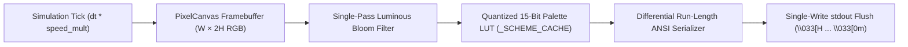

# System Architecture & Rendering Pipeline

## 1. High-Level Rendering Pipeline

Animation King operates a single-threaded simulation and rasterization loop designed to run smoothly at 60–120+ FPS inside modern terminal emulators.



## 2. Sub-Cell Dual-Pixel Vertical Rasterization (`W × 2H`)

Standard terminal cells are roughly twice as tall as they are wide. To prevent vertical stretching, [`PixelCanvas`](src/animationking/core/canvas.py) splits each cell into two vertical sub-pixels using the Unicode upper-half block glyph (`▀`, `U+2580`):

* **Top Sub-Pixel `(col, row * 2)`**: Cell foreground color (`\033[38;2;R;G;Bm`).
* **Bottom Sub-Pixel `(col, row * 2 + 1)`**: Cell background color (`\033[48;2;R;G;Bm`).

This doubles effective vertical resolution, turning an `80 × 24` terminal into an `80 × 48` pixel canvas, while leaving a text overlay layer available for HUD badges and labels.

## 3. Framebuffer Primitives & Post-Processing

### Additive & Alpha-Blended Drawing
[`PixelCanvas`](src/animationking/core/canvas.py) provides core drawing primitives:
* **`set_pixel(x, y, color)`**: Direct RGB assignment with bounds clipping.
* **`add_pixel(x, y, color, intensity)`**: Clamped additive blending (`min(255, dst + src * intensity)`), useful for particle trails and glow.
* **`blend_pixel(x, y, color, alpha)`**: Alpha compositing.
* **Bresenham & Polygons**: `draw_line()`, `draw_circle()`, and scanline `draw_triangle()` for wireframes and 3D shapes.

### Luminous Bloom Filter
When enabled, `PixelCanvas.apply_bloom()` finds bright pixels above a threshold and spreads a quick 4-neighbor glow halo into adjacent cells.

## 4. Quantized Color Scheme LUT (`_SCHEME_CACHE`)

Running HSV conversions per pixel on every frame in pure Python is too slow for 60+ FPS.

[`colors.py`](src/animationking/core/colors.py) quantizes the lower 3 bits of each RGB channel:

```python
key = (scheme, r & 0xF8, g & 0xF8, b & 0xF8)
```

This reduces the color space to a 32,768-entry cache per scheme that hits `>99%` of the time after the first frame, avoiding per-pixel math.

## 5. Differential Run-Length ANSI Serialization

Terminal emulators slow down when flooded with redundant escape codes. `PixelCanvas.render()` optimizes output:

1. **Differential SGR Tracking**: Tracks foreground and background state, only emitting escape sequences when a color actually changes:
   * Both changed: `\033[38;2;R1;G1;B1;48;2;R2;G2;B2m▀`
   * Only top changed: `\033[38;2;R1;G1;B1m▀`
   * Only bottom changed: `\033[48;2;R2;G2;B2m▀`
   * Unchanged: `▀`
2. **Single stdout Write**: Scanlines are joined and flushed in a single write call with cursor home (`\033[H`), avoiding screen tearing and cursor flicker.

## 6. Non-Blocking Terminal Input & Clean Exit

[`TerminalController`](src/animationking/core/input.py) handles raw terminal input:

* **Raw Mode**: Sets `termios` to non-canonical, non-echoing mode, polling `sys.stdin` non-blockingly with `select.select()`.
* **Key Parsing**: Disambiguates ANSI escape sequences (arrows, PageUp/PageDown, ESC).
* **Signal Handlers**: Traps `SIGINT`, `SIGTERM`, and `SIGWINCH` to unconditionally restore cursor visibility (`\033[?25h`), exit alternate screen buffers (`\033[?1049l`), and reset `termios` attributes on exit.
